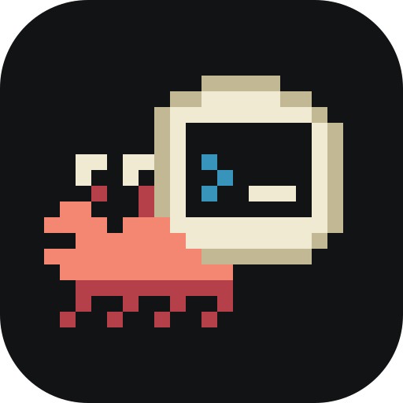

# Ela

A remote connection manager for SSH and RDP, in the spirit of MobaXterm and Remmina. Built with Rust, Tauri and Svelte.

Ela is young: it runs on Linux only and hasn't had an outside security review. VNC, Tunnels and more Protocols are planned ([roadmap](docs/architecture.md#10-roadmap)).

## What it does

- **SSH** terminals that follow your `~/.ssh/config` and `known_hosts`, with identity files, ssh-agent and passwords.
- **RDP** desktops that resize with the window and share clipboard text.
- **Jump Hosts**, including chains, for both.
- **Files** over SSH: browse, upload, download, drag and drop.
- **A Connection tree** with Folders whose settings are inherited, tags and search. Each Connection is one TOML file.
- **A Vault** for passwords and key passphrases, encrypted with AES-256-GCM and a key from Argon2id.

## Build

You need Rust 1.94+, [bun](https://bun.sh), and the [Tauri Linux dependencies](https://tauri.app/start/prerequisites/#linux).

```sh
cd app
bun install
bun tauri build
```

Packages land in `target/release/bundle/`.

## Develop

`bun tauri dev` in `app/` runs the desktop app. `bun run dev` runs only the UI, in a browser, against a fake backend.

Tests, which need `ssh-keygen`:

```sh
cargo test --workspace
cd app && bun run check && bun run test
```

Docker test servers for SSH and RDP (user `ela`, password `ela`), and the tests that use them:

```sh
cd dev && ./gen-keys.sh && docker compose up -d
cargo test -p ela-ssh -p ela-rdp -- --ignored
```

The docs explain how it fits together:

- [Architecture](docs/architecture.md) and [decisions](docs/adr/)
- [Design](docs/design/README.md)
- [Glossary](GLOSSARY.md)
- [Changelog](CHANGELOG.md) and [releasing](docs/releasing.md)
- [Reporting a vulnerability](SECURITY.md)

## License

Copyright (C) 2026 Galih

Ela is free software under the [GNU General Public License](LICENSE), version 3 or any later version.

This software is based in part on the work of the Independent JPEG Group.
